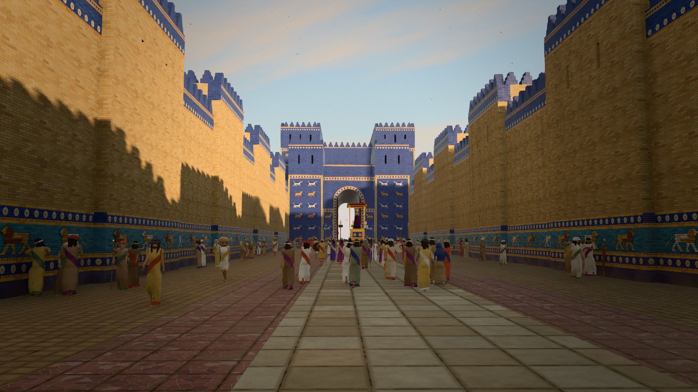
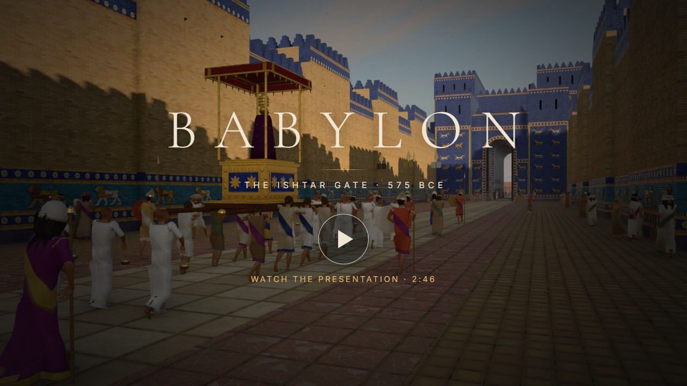
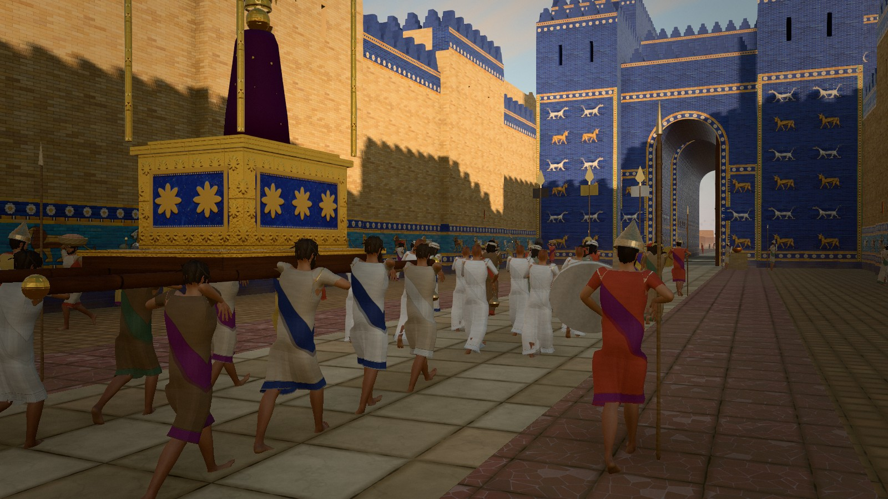
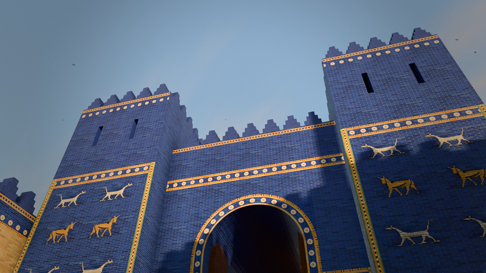
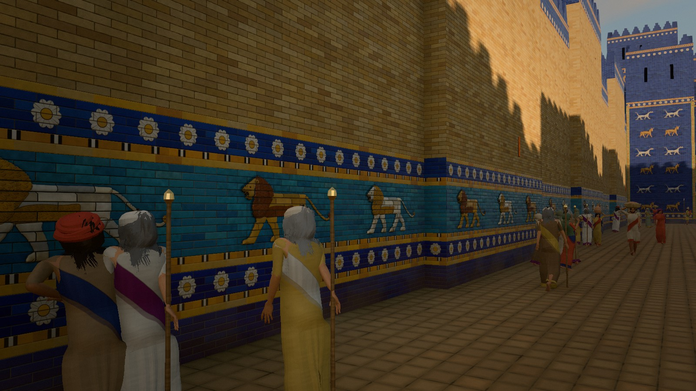
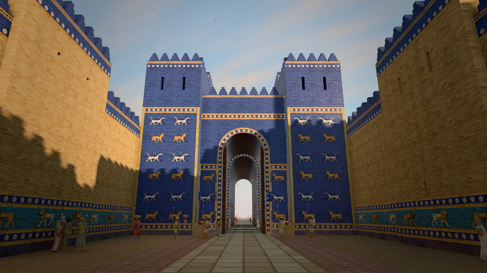
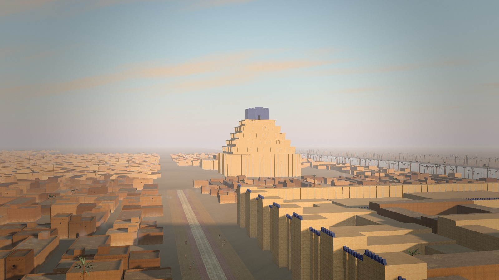
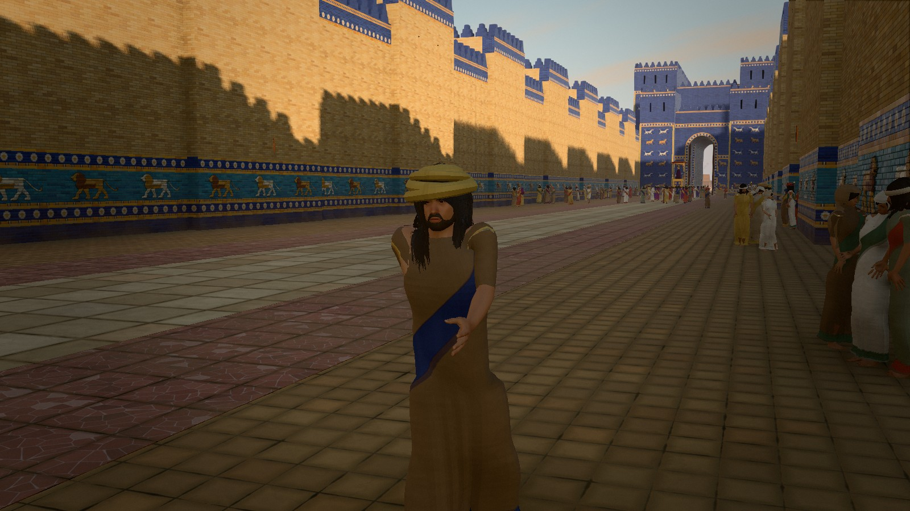
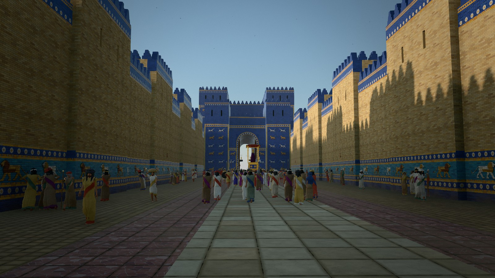
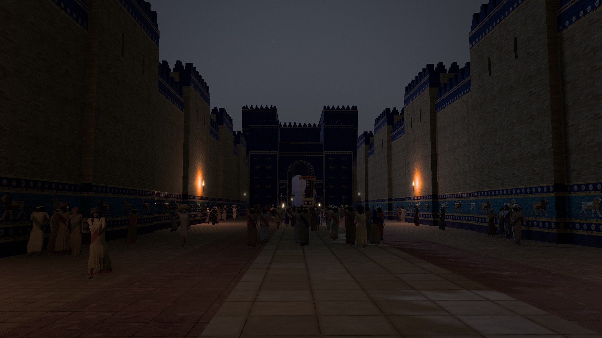

<div align="center">

# BABYLON — The Ishtar Gate, 575 BCE

**A cinematic, real-time 3D reconstruction of ancient Babylon that runs in your web browser.**

Walk the Processional Way between glazed lions, watch the Akitu procession carry the god's statue,
and pass through the Ishtar Gate into the city of Nebuchadnezzar II.

[▶ Watch the presentation video](#presentation-video) ·
[Run it on your computer](#quick-start) ·
[Screenshots](#screenshots) ·
[Русская версия](README.ru.md)



</div>

---

## Contents

- [What is this?](#what-is-this)
- [Presentation video](#presentation-video)
- [Quick start](#quick-start)
- [Controls](#controls)
- [Graphics quality and URL options](#graphics-quality-and-url-options)
- [Troubleshooting](#troubleshooting)
- [Screenshots](#screenshots)
- [What is inside](#what-is-inside)
- [How it works](#how-it-works)
- [Project structure](#project-structure)
- [Historical basis and artistic licence](#historical-basis-and-artistic-licence)
- [Performance](#performance)
- [Known limitations](#known-limitations)
- [Credits and licences](#credits-and-licences)

## What is this?

Around 575 BCE King Nebuchadnezzar II rebuilt the northern entrance of Babylon: a double gate faced with
cobalt-blue glazed brick and rows of moulded bulls and dragons, approached by a walled street lined with
striding lions. This project rebuilds that place as an interactive scene. It runs in real time in an
ordinary web browser.

- **No installation for viewers beyond a browser.** The scene is a static website built with
  [three.js](https://threejs.org) (WebGL 2), TypeScript and [Vite](https://vite.dev).
- **Two ways to visit.** Watch a ~65-second cinematic camera tour, or walk around on your own in first person.
- **Four times of day.** Morning, midday, golden hour and a moonlit night with oil lamps and braziers.
- **A living city.** About 240 people, a religious procession, birds, smoke, dust in the sunbeams and a
  procedurally generated soundscape (crowd, drums, lyres, wind, birds, fire).

It aims for the look of a historical film, but it is honest about what it is: real-time graphics in a browser,
built from procedural textures and freely licensed (mostly CC0) assets. It is not a photogrammetry scan
and not a scholarly 1:1 model. See [Historical basis](#historical-basis-and-artistic-licence) for what is
reconstructed and what is interpretation.

## Presentation video

A 40-second teaser (720p, with sound) — press play:

https://github.com/user-attachments/assets/68b5285d-363f-4e11-9f49-d81d0e1f560b

**The full film** (2 min 46 s, 1920×1080, 30 fps, 158 MB) is rendered frame by frame from the real-time scene.
It carries the scene's own procedural sound and has no music:

[](https://github.com/Borq1000/babylon-ishtar-gate/releases/download/v1.0.0/babylon-presentation-1080p.mp4)

⬇ [Download `babylon-presentation-1080p.mp4`](https://github.com/Borq1000/babylon-ishtar-gate/releases/download/v1.0.0/babylon-presentation-1080p.mp4) ·
[release page](https://github.com/Borq1000/babylon-ishtar-gate/releases/tag/v1.0.0)

## Quick start

### 1. Requirements

| | |
|---|---|
| **Node.js** | version 18 or newer (tested with 22). Download from [nodejs.org](https://nodejs.org) — the LTS installer also installs `npm`. |
| **Git** | optional: you can also download the ZIP from GitHub (green **Code** button → **Download ZIP**). |
| **Browser** | a desktop browser with WebGL 2: Chrome or Edge (recommended), Firefox, Safari 17+. |
| **Graphics** | any recent GPU. A dedicated graphics card gives the best result; integrated graphics work on the **Low** preset. |
| **Disk / download** | about 200 MB including dependencies. |

Check that Node.js is installed by opening a terminal (PowerShell, Terminal or a shell) and typing:

```bash
node --version
```

### 2. Get the project and start it

```bash
git clone https://github.com/Borq1000/babylon-ishtar-gate.git
cd babylon-ishtar-gate
npm install
npm run dev
```

Then open **http://localhost:5173** in your browser and click **Enter Babylon**.
The first load takes a few seconds: textures are generated on the GPU and the relief panels are sculpted
in background threads.

To stop the server, press `Ctrl+C` in the terminal.

### 3. Optional: a production build

```bash
npm run build      # type-checks and writes an optimised static site to dist/
npm run preview    # serves dist/ at http://localhost:4173
```

The contents of `dist/` can be uploaded to any static web host (GitHub Pages, Netlify, Cloudflare Pages,
an ordinary web server). If the site will live in a sub-folder, build it with the matching base path,
for example `npx vite build --base=/babylon-ishtar-gate/`.

## Controls

| Input | Action |
|---|---|
| **Enter Babylon** | start the cinematic tour (about 65 s), then continue on foot |
| **Cinematic Tour / Explore** | switch between the tour and free exploration (title screen and bottom bar) |
| `W` `A` `S` `D` or arrow keys | walk (Explore mode) |
| Mouse | look around — click the scene first to capture the mouse |
| `Shift` | walk faster |
| `Esc` | release the mouse |
| `H` | hide / show the interface |
| `P` | show frame rate, draw calls and triangle count |

**Time of Day**, **Graphics Quality** and **Sound** can be changed on the title screen and in the bottom bar.
Sound starts only after your first click, as browsers require.

## Graphics quality and URL options

The app picks a quality preset from your GPU automatically; you can change it at any time.

| Preset | Intended for | What changes |
|---|---|---|
| **Low** | integrated graphics, older laptops | lower resolution, smaller shadow maps, no ambient occlusion or light shafts, fewer people and dust particles |
| **High** | most dedicated GPUs (default) | full scene, half-resolution ambient occlusion, volumetric light shafts |
| **Ultra** | RTX 3060-class GPUs and better | 4K shadow maps, full-resolution AO, more light-shaft samples, 4× MSAA, higher pixel ratio |

On every preset the resolution adapts automatically to keep the frame rate smooth.

Optional URL parameters (handy for bookmarks, screenshots and debugging):

| Parameter | Example | Effect |
|---|---|---|
| `q` | `?q=low` | force a quality preset: `low`, `high`, `ultra` |
| `time` | `?time=night` | start at `morning`, `midday`, `golden` or `night` |
| `tour` | `?tour` | start the cinematic tour immediately |
| `cam` | `?cam=0,1.7,40,0,10,0` | freeze the camera at position `x,y,z` looking at `tx,ty,tz` and hide the interface |

Example: `http://localhost:5173/?q=high&time=night`

## Troubleshooting

| Problem | What to try |
|---|---|
| **Black screen or "failed to start"** | Your browser needs WebGL 2. Make sure hardware acceleration is enabled (Chrome: *Settings → System → Use graphics acceleration*), update the graphics driver, and check `chrome://gpu`. |
| **Low frame rate** | Choose **Low** in *Graphics Quality*, close other heavy tabs, plug in the laptop and make sure the browser uses the dedicated GPU (Windows: *Settings → Display → Graphics*). |
| **No sound** | Click **Enter Babylon** or the **Sound** toggle — browsers block audio until you interact with the page. |
| **`npm install` fails** | Update Node.js to version 18 or newer and try again; behind a proxy, configure `npm config set proxy …`. |
| **Port 5173 is busy** | Run `npm run dev -- --port 3000` and open http://localhost:3000. |
| **The mouse does not turn the view** | In Explore mode click once on the scene to capture the mouse; press `Esc` to release it. |

## Screenshots

| | |
|---|---|
|  |  |
| The Akitu procession approaches the gate | The Ishtar Gate from the street |
|  |  |
| Glazed lions of the Processional Way | Bulls and mušḫuššu dragons on the gate towers |
|  |  |
| The city and the Etemenanki ziggurat | People of Babylon |
|  |  |
| Morning | Night |

## What is inside

**The Ishtar Gate (the hero of the scene).**
- The complete double gate:
  - a front gate and a light-well;
  - a 33-metre-deep main gate whose arch rises about 11.8 m.
- Cedar door leaves with bronze straps.
- Stepped glazed crenellations, framing strips and bands of rosettes.
- Six alternating rows of aurochs (*rīmu*) and *mušḫuššu* dragons. Outside they walk towards the passage, inside it they walk into the city.

**The Processional Way.**
- 180 m of street between glazed walls with shallow towers.
- 60 striding lions on each wall, in the colour order of the Berlin reconstruction.
- Paving of limestone slabs in the middle and red breccia at the sides, with bitumen joints.
- The North Gate, an 80-metre moat with a causeway, and the outer and inner city walls.

**The relief panels.**
- Lion, bull and dragon outlines were traced from photographs of original museum panels (public domain / CC0).
- The outlines are turned into real displaced geometry:
  - a distance field gives the "sculpted" profile;
  - mane locks, scales and curls are added;
  - the joints of the moulded bricks run straight through the animals, as on the originals.
- Edges follow the running-bond joints, so every panel sits seamlessly in the brick wall.

**The city.**
- The Southern and Northern Palaces with courtyards, the whitewashed temple of Ninmah, and the Esagila.
- Etemenanki, with terraces after the Tower of Babel stele and a blue temple on top.
- The Euphrates, palm groves, fields, about 1,000 detailed houses and thousands of distant ones.

**People.**
- About 240 people in eight types: townsmen, merchants, nobles, guards, porters, shaven-headed priests, elders and women.
- Bodies, faces, eyes, hair and beards are CC0 [MakeHuman](http://www.makehumancommunity.org) assets, assembled in Blender.
- Neo-Babylonian clothing is generated to fit each body: long and short tunics with folds, fringed shawls, veils, headbands, turbans, caps and helmets.
- Movement is real motion capture from the CMU database: walking, slow walking, marching, standing, talking, waving.
- They carry spears, shields, standards with Marduk's spade emblem, drums, lyres, censers, staffs, baskets and jars.

**Light and atmosphere.**
- A physically based sky that also lights the scene, and cascaded sun shadows.
- Aerial perspective with volumetric light shafts, ambient occlusion and a restrained colour grade.
- Dust that is visible only in sunbeams, hearth smoke, incense and swifts.

**Sound.**
- Generated live with the Web Audio API — no recorded music.
- Crowd murmur and positional voices, the procession's drums, cymbals and lyre.
- Footsteps, wind, birds, crickets at night, crackling fire and water.

## How it works

<details>
<summary><b>Rendering pipeline</b></summary>

- **Lighting.** three.js r186 `WebGLRenderer`, linear HDR lighting, the native `SunLight` with two shadow cascades.
- **Image-based light.** The sky model (Preetham) is rendered into a PMREM environment map, so the glaze reflects exactly the sky you see.
- **Post-processing** with [pmndrs/postprocessing](https://github.com/pmndrs/postprocessing):
  - N8AO ambient occlusion;
  - a custom atmosphere pass with height fog and ray-marched light shafts from a dedicated shadow map;
  - bloom, Khronos PBR Neutral tone mapping, a colour grade and SMAA.
- **Materials.** Standard materials are patched in GLSL:
  - per-pixel self-shadowing of brick joints and reliefs (ray-marching the height map);
  - weathering, dust and rain streaks;
  - large-scale "sky visibility" for the street canyon and the gate tunnels;
  - an analytic bounce of sunlight inside the Processional Way.

</details>

<details>
<summary><b>Procedural textures and architecture</b></summary>

- All brick, glaze, paving and ornament textures are generated on the GPU at start-up.
  - Every glazed brick gets its own tone, firing batch, edge thinning and glaze pooling.
  - Photo textures (CC0, [Poly Haven](https://polyhaven.com)) are used only for sand, plaster, wood, fabric and palm bark.
- The architecture is built in code from a measured layout (`src/world/Layout.ts`).
  - All courses snap to a single brick module (33 × 8.3 cm), so joints line up across walls, bands and relief panels.

</details>

<details>
<summary><b>People: from MakeHuman to the browser</b></summary>

1. **Assembly in Blender.** Python scripts in `tools/people/` build each body type with the MPFB 2 add-on:
   - create the body and skeleton;
   - fit hair, beard and eyes;
   - generate the garments and remove the hidden body parts;
   - retarget CMU motion-capture clips onto the skeleton.
2. **Hand-held props.** The arms are re-posed with analytic IK, and each prop is bound rigidly to a hand or the head.
3. **Export.** Every archetype goes into a Draco-compressed glTF with four levels of detail (~26k → ~0.8k triangles).
4. **In the browser,** all clips are sampled into one floating-point texture of bone matrices, and the GPU skins every person from it.
   - All people of one type and detail level are drawn in a single instanced draw call.
   - Each person only stores two "animation cursors": clip row and phase.
   - Walking phase advances with the distance actually walked, so feet do not slide.
5. **Shadows** come from cheap low-detail stand-ins.

</details>

<details>
<summary><b>Camera, tour and exploration</b></summary>

- **Tour.** A spline (centripetal Catmull–Rom) with a monotone time mapping. Captions appear at each stage of the route.
- **Explore mode.**
  - Pointer-lock first-person controller at eye height with gentle head bob.
  - Simple 2D collision against walls, houses and market stalls.
  - The walkable area is limited to the streets and squares.

</details>

## Project structure

```
src/
  core/          app shell, frame loop, quality presets, adaptive resolution
  rendering/     post-processing chain, atmosphere / light-shaft pass, colour grading
  materials/     GPU texture baking, material library, GLSL material patches
  shaders/       shared GLSL: noise, brick generators, sky
  architecture/  gates, walls and paving (Monuments), city (City), relief panels (reliefs/)
  characters/    people loader + animation baking, GPU-skinning shader, crowd and procession
  environment/   sky, time of day, palms, water, dust, smoke, birds, market, night lights
  camera/        cinematic tour, first-person controller, collisions
  audio/         procedural Web Audio soundscape
  ui/            interface and styles
  dev/           relief tracing page: /dev/relief.html?a=lion&mode=trace
public/          CC0 textures and models, the people (models/people)
tools/people/    Blender scripts that build the people (not part of the web build)
reference/       museum photographs used for tracing (not part of the web build)
docs/            screenshots and the video poster
```

Useful commands:

| Command | Purpose |
|---|---|
| `npm run dev` | development server with hot reload |
| `npm run build` | type-check and production build into `dist/` |
| `npm run preview` | serve the production build |
| `npm run typecheck` | TypeScript check only |

## Historical basis and artistic licence

The reconstruction follows:
- R. Koldewey, *The Excavations at Babylon* (1914);
- O. Pedersén, *Babylon: The Great City* (2021, open access), and his 2024 article on the Tower of Babel stele;
- the Pergamon Museum reconstruction in Berlin;
- glazed-brick panels in the Metropolitan Museum and the Istanbul Archaeology Museums.

Where the evidence is missing or disputed, plausible choices were made and are listed here:

- **Wall height.** The height of the Processional Way walls is unknown (Berlin uses 12.5 m). Here they are 11 m, so that the gate dominates.
- **Direction of the lions.** It is debated. Here the lions walk north, towards people entering the city (Berlin and Pedersén).
- **Golden-hour sun.** It stands further north-west than the true summer azimuth (322° instead of ≈295°), so the light can reach the bottom of the walled street.
- **Etemenanki.** It stands somewhat closer to the gate than in reality (≈650 m instead of ≈800 m), so it reads well from the air.
- **The Berlin "Nebuchadnezzar inscription"** is not reproduced: it is a modern assembly whose original position is unknown.
- **Clothing, weapons and the procession** are a plausible reconstruction. Direct Neo-Babylonian depictions are rare.

## Performance

Measured on a laptop with an NVIDIA GeForce RTX 2050 (4 GB) in Chrome (ANGLE / Direct3D 11):

| | |
|---|---|
| Loading to the title screen | about 4–6 s (GPU texture baking, relief sculpting in Web Workers, shader compilation) |
| High preset, 1920×1080 | about 60 fps in the opening view; adaptive resolution holds the frame rate in heavy views |
| High preset, 1280×720 | 6–7 ms per frame |
| The crowd of ~240 people | adds about 4 ms per frame at 1600×900 |
| Size of `public/` assets | about 62 MB (CC0 photo textures ~40 MB, people ~9 MB, other models ~13 MB); JavaScript ~420 kB gzipped |

## Known limitations

- **Clothing.** There is no cloth simulation: skirts follow the skeleton, and shawls and borders are painted in the shader. Up close you can see the seam where the sleeve meets the tunic.
- **Hair and faces.** Hair and beards are alpha-tested cards. Faces have no expressions.
- **Light.** There is no full global illumination or screen-space reflections. Bounced light and sky reflections are approximated.
- **Light shafts** are computed from the large architecture only. People and palms do not cut them.
- **Mobile devices** have not been tested. Expect to need a recent device and the Low preset.

## Credits and licences

- **Code:** [MIT License](LICENSE).
- **Blender build scripts** in `tools/people/`: GPL-3.0-or-later, because they call the GPL-licensed MPFB add-on (see [tools/people/LICENSE](tools/people/LICENSE)).
- **Third-party assets** keep their own licences. Full details are in [ASSET_CREDITS.md](ASSET_CREDITS.md):
  - textures and props: [Poly Haven](https://polyhaven.com), CC0;
  - people (bodies, hair, beards): [MakeHuman](http://www.makehumancommunity.org) community asset packs, CC0;
  - motion capture: [CMU Graphics Lab Motion Capture Database](http://mocap.cs.cmu.edu) ("free for all uses"), in Bruce Hahne's BVH conversion;
  - fonts: Cormorant Garamond and Inter, SIL Open Font License;
  - libraries: three.js (MIT), postprocessing (Zlib), n8ao (ISC).
- **Reference photographs** used for tracing the reliefs are listed with sources and licences in [reference/SOURCES.md](reference/SOURCES.md):
  - The Met (CC0);
  - Wikimedia Commons (CC0 / public domain / CC BY-SA);
  - O. Pedersén (CC BY).
- **Generated in this project:** the architecture, procedural textures, relief panels, garments, props, palms, smoke, birds and all sound.
